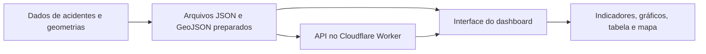

# Painel de Acidentes em Rodovias Federais

O Painel de Acidentes em Rodovias Federais é um dashboard interativo para explorar registros de acidentes nas rodovias federais brasileiras entre 2017 e 2024.

**[Acessar o dashboard](https://dashboard-acidentes-prf.guisoaresg7.workers.dev/)**

## Visão geral

O painel reúne indicadores e gráficos para observar a frequência e a gravidade dos acidentes. Os dados podem ser analisados por ano e por estado (UF), usando os filtros no próprio dashboard.

Entre as informações apresentadas estão:

- totais de acidentes, mortes e feridos;
- evolução anual de acidentes e mortes;
- taxa de severidade;
- distribuição de acidentes por horário;
- principais causas registradas;
- comparação e ranking entre estados;
- tabela detalhada dos registros disponíveis no recorte selecionado.

Os filtros de ano e estado atualizam os indicadores, gráficos, tabela e dados de ocorrências do mapa. A seleção de uma rodovia federal (BR) é específica do mapa: ela destaca a rodovia escolhida e exibe as ocorrências associadas, sem alterar os demais indicadores do painel.

## Mapa interativo

O mapa é desenhado com geometrias vetoriais próprias do Brasil, dos estados e das rodovias federais. Assim, os limites e os traçados não dependem de um mapa-base externo.

É possível selecionar uma BR pelo menu ou clicando diretamente em seu traçado. Quando uma rodovia é selecionada, ela ganha destaque e as demais ficam apagadas para facilitar a leitura. Os controles de zoom permitem aproximar e afastar a visualização.

O controle **Acidentes** oferece três modos:

- **Pontos:** mostra ocorrências individualmente no mapa;
- **Calor:** representa a concentração espacial dos acidentes;
- **Ocultar:** esconde as ocorrências e mantém a visualização geográfica e rodoviária.

O recorte do mapa acompanha os filtros de ano e estado. Para manter a navegação responsiva, a visualização pode exibir uma amostra limitada de ocorrências; o painel informa o total correspondente ao recorte quando uma BR é selecionada.

## Como o dashboard funciona

Os dados de acidentes e as geometrias geográficas são preparados antes de serem publicados. Essa etapa transforma as fontes em arquivos JSON e GeoJSON menores e organizados por finalidade, como resumos, mapas, tabelas, limites estaduais e trechos rodoviários.

No site, a interface carrega os arquivos estáticos e solicita à API os dados correspondentes aos filtros selecionados. A API valida o ano e a UF, localiza o arquivo preparado para aquela combinação e devolve a resposta em JSON. Os resumos são mantidos em cache durante a execução do Worker para evitar leituras repetidas.

Esse fluxo permite que o site apresente as informações sem processar o CSV bruto a cada acesso:



## Dados em JSON

Os arquivos JSON são preparados antes da publicação. O site não baixa a base inteira: solicita somente a página de registros ou a distribuição necessária para os filtros atuais. O CSV atual contém 547.347 registros e 30 colunas.

- **Resumo:** agrega indicadores e séries para o painel, incluindo combinações de ano e UF.
- **Distribuições:** agrega as dimensões categóricas da base, como condição meteorológica, dia, horário, causa, tipo, município, BR e unidade operacional, com contagens de acidentes e totais de pessoas, vítimas e veículos.
- **Registros completos:** preserva todos os 30 campos em blocos JSON separados por ano e UF. O manifesto descreve o esquema e os blocos; a API entrega páginas, sem exigir que o navegador carregue todos os arquivos.
- **Mapas:** contém ocorrências geolocalizadas para o mapa geral e para recortes filtrados.
- **Geometrias:** arquivos GeoJSON descrevem limites do Brasil e estados, além dos trechos de rodovias.
- **Acidentes por BR:** arquivos separados permitem consultar e desenhar ocorrências associadas a cada rodovia.

Os totais e distribuições usam todos os registros do CSV, inclusive os que não têm coordenadas válidas. Somente esses registros geolocalizados podem aparecer no mapa. Os arquivos em `public/data/` são recursos públicos e não devem conter informações privadas. Os blocos completos são particionados para respeitar o limite de tamanho por arquivo dos Static Assets da Cloudflare.

## API do dashboard

As rotas `/api/*` fornecem os dados consumidos pela interface. As rotas de resumo aceitam os parâmetros opcionais `ano` e `uf`.

| Rota | Dados fornecidos |
|---|---|
| `/api/stats_gerais` | Totais de acidentes, mortes e feridos |
| `/api/acidentes_por_ano` | Série anual de acidentes |
| `/api/mortos_por_ano` | Série anual de mortes |
| `/api/taxa_severidade` | Indicadores de severidade |
| `/api/heatmap_horarios` | Distribuição por horário |
| `/api/ranking_estados` | Ranking das UFs |
| `/api/causas` | Principais causas registradas |
| `/api/estados` | Totais por UF |
| `/api/mapa` | Ocorrências para o mapa |
| `/api/tabela_detalhada` | Amostra preparada para compatibilidade |
| `/api/distribuicao` | Distribuição paginada por uma dimensão e métrica |
| `/api/registros` | Registros completos paginados, com todos os campos do CSV |
| `POST /api/analista/consulta` | Consultas determinísticas; não chama um modelo de IA |
| `GET /api/analista/status` | Informa se a IA e o limitador estão habilitados e configurados |
| `POST /api/analista/perguntar` | Interpreta uma pergunta com Workers AI e executa somente uma consulta determinística permitida |

O endpoint de consulta recebe um objeto JSON com uma operação e seus parâmetros. Operações disponíveis:

- `consultar_resumo`: `ano`, `uf` e `metrica` opcionais; métricas aceitas: acidentes, mortes, feridos, feridos leves/graves, pessoas, ilesos, ignorados e veículos.
- `comparar_estados`: `ufs` (2 a 10 siglas), `metrica` e `ano` opcionais; aceita as mesmas métricas de resumo.
- `listar_causas`: `ano`, `uf` e `limite` opcionais; o limite máximo é 10.
- `consultar_serie`: `metrica`, `uf`, `ano_inicio` e `ano_fim` opcionais; além de acidentes, mortes e feridos, aceita feridos leves/graves, pessoas, ilesos, ignorados e veículos.
- `consultar_distribuicao`: `dimensao` e `metrica` obrigatórias; aceita os filtros `ano` e `uf` e paginação por `pagina`/`por_pagina` (máximo 100). Dimensões incluem condição meteorológica, mês, dia da semana, fase/hora do dia, causa, tipo, classificação, UF, BR, município, regional, delegacia e UOP. Métricas incluem acidentes, mortes, tipos de feridos, pessoas, ilesos, ignorados e veículos.

`GET /api/distribuicao` expõe a mesma consulta para o dashboard. Exemplo: `/api/distribuicao?dimensao=condicao_metereologica&metrica=acidentes&ano=2023&uf=GO`.

Exemplo de corpo para uma consulta determinística sobre clima:

```json
{
  "operacao": "consultar_distribuicao",
  "dimensao": "condicao_metereologica",
  "metrica": "acidentes",
  "ano": 2023,
  "por_pagina": 5
}
```

`GET /api/registros` aceita `ano` e `uf` opcionais, `pagina` (a partir de 1) e `por_pagina` (padrão 50, máximo 100). A resposta informa o total do recorte e contém cada registro com os 30 campos do CSV. A ordem é por ano, UF e ordem original dentro de cada partição. Registros sem data/UF válida continuam disponíveis sem filtros, mas não entram em um recorte que exija essa informação.

Exemplo de comparação:

```json
{
  "operacao": "comparar_estados",
  "ano": 2023,
  "ufs": ["GO", "SP"],
  "metrica": "mortes"
}
```

O endpoint valida a consulta e retorna os valores estruturados com filtros e fonte. Ele não interpreta linguagem natural. As distribuições e séries são calculadas de forma determinística a partir dos dados preparados, sem SQL arbitrário.

O endpoint de linguagem natural recebe `{"pergunta":"Quantos acidentes foram registrados em 2022?"}`. A resposta inclui o texto montado a partir dos resultados, a operação, os filtros e a fonte; o modelo não calcula os números nem fornece texto livre ao usuário. Ele também pode consultar distribuições históricas, inclusive de condições meteorológicas. Essas contagens não demonstram causalidade, não medem risco sem exposição ao tráfego e não geram previsão nem alerta operacional. Perguntas fora do escopo devem ser recusadas.

Workers AI usa o binding `AI`, com o modelo `@cf/zai-org/glm-4.7-flash`. O recurso fica desativado por padrão em `wrangler.jsonc` (`ANALYST_AI_ENABLED: "false"`); chamadas reais só ocorrem depois de habilitá-lo. A pergunta é limitada a 500 caracteres e a geração a 160 tokens. Não há integração com AI Gateway nem armazenamento próprio das perguntas.

O dashboard exibe um formulário para perguntas e consulta `/api/analista/status` antes de habilitá-lo. Quando a IA, o binding ou o limitador de chamadas estiverem desativados ou ausentes, o formulário permanece desabilitado. A consulta em linguagem natural usa somente os filtros escritos na pergunta; os filtros gerais do dashboard não são aplicados.

O [Workers AI oferece 10.000 Neurons gratuitos por dia](https://developers.cloudflare.com/workers-ai/platform/pricing/). Para `@cf/zai-org/glm-4.7-flash`, a tabela atual informa 5.500 Neurons por milhão de tokens de entrada e 36.400 por milhão de tokens de saída; os 160 tokens máximos de saída representam até 5,824 Neurons por resposta, além do custo de entrada. No Workers Paid, o excedente custa US$ 0,011 por 1.000 Neurons; no Workers Free, operações após a cota diária falham. Chamadas locais de inferência também consomem a cota.

O endpoint de perguntas usa o [Rate Limiting API do Workers](https://developers.cloudflare.com/workers/runtime-apis/bindings/rate-limit/), configurado para 5 chamadas por minuto por IP. O limite é aproximado e aplicado separadamente por localidade Cloudflare; não é um teto diário ou global de gastos, e usuários atrás do mesmo IP podem compartilhar o limite. Não habilite a IA em uma conta paga contando com esse limitador como proteção de orçamento. Um teto rígido de consumo exigiria controle global persistente, ainda não implementado. O recurso continua desligado por padrão enquanto essa proteção e a cota da conta não forem suficientes para o uso pretendido.

O `namespace_id` do limitador em `wrangler.jsonc` precisa ser único na conta Cloudflare; se já estiver em uso por outro Worker, escolha outro número inteiro antes de publicar.

O conjunto de perguntas de referência em `tests/fixtures/analyst_questions.json` registra consultas esperadas, resultados e exemplos fora do escopo, como previsões futuras e comparações de risco sem dados de exposição. Os testes verificam o contrato das consultas determinísticas com os dados preparados; ainda não medem seleção de ferramentas ou extração de filtros por um modelo de linguagem.

O período coberto é de 2017 a 2024. Uma UF deve ser informada pela sigla oficial, como `SP` ou `BA`.

## Fontes dos dados

- **Acidentes:** dataset [Acidentes em Rodovias Federais](https://www.kaggle.com/datasets/guilherme2008/acidentes-em-rodovias-federais), baseado em registros da PRF.
- **Rodovias:** [DNIT/Infra S.A. — Rodovias Federais, SNV 202501A](https://geo.infrasa.gov.br/server/rest/services/Hosted/Rodovias_Federais/FeatureServer/0).
- **Limites do Brasil e das UFs:** [IBGE — API de Malhas Geográficas](https://servicodados.ibge.gov.br/api/docs/malhas?versao=3).

## Tecnologias

O projeto usa Python, Flask e Cloudflare Workers na API; Workers Static Assets para servir a interface e os dados preparados; e JavaScript, Chart.js e Leaflet para os gráficos e as interações do navegador.

## Processo de desenvolvimento e uso de IA

O desenvolvimento combinou decisões e iterações do autor com o uso do **ChatGPT (modelo GPT-6, acessado pelo Codex)** como ferramenta de apoio. A IA auxiliou na implementação de funcionalidades, investigação de problemas, ajustes de responsividade e documentação.

O autor conduziu a evolução do produto: definiu os objetivos e prioridades, avaliou as sugestões, escolheu os comportamentos do mapa e dos filtros, e refinou a experiência a partir dos resultados observados. Esse processo demonstra aplicação prática de análise de requisitos, integração de dados, desenvolvimento web e avaliação iterativa de soluções com IA.

## Código-fonte

O código do projeto está disponível no [GitHub](https://github.com/guig7/Dashboard_acidentes).

## Licença

Este projeto está sob a licença MIT. Consulte o arquivo [License](License).

