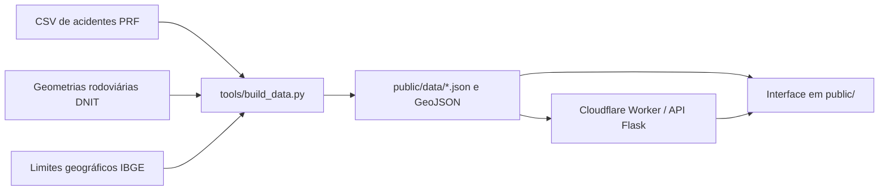

# Painel de Acidentes em Rodovias Federais

Dashboard interativo sobre acidentes registrados em rodovias federais brasileiras entre 2017 e 2024. O projeto combina uma interface web, uma API Flask executada em Cloudflare Workers e arquivos JSON pré-processados.

## O que o dashboard mostra

- Indicadores de acidentes, mortes e feridos.
- Evolução anual, acidentes por horário, severidade, ranking por estado e principais causas.
- Filtros gerais por ano e estado.
- Mapa vetorial próprio, sem tiles de mapas externos, com contorno do Brasil, limites estaduais e traçados das rodovias federais.
- Seleção de BR pelo seletor ou clicando em um traçado. A rodovia escolhida fica destacada e o mapa mostra os acidentes correspondentes.
- Visualização das ocorrências como **Pontos**, **Calor** ou **Ocultar**. Os filtros de ano e estado também reduzem os pontos do mapa.

O filtro de BR afeta o mapa. Os outros indicadores continuam agregados pelos filtros de ano e estado.

## Como os dados chegam ao site



O CSV é processado localmente com Pandas. O gerador cria resumos para 252 combinações de ano e estado, arquivos de mapa e tabela, geometrias vetoriais e listas de acidentes por BR. Isso evita carregar o CSV bruto dentro do Worker.

O Worker serve a interface estática e responde às rotas `/api/*`. Os endpoints leem os arquivos gerados pelo vínculo `ASSETS`; o resumo é mantido em cache durante a execução do Worker. O Wrangler está configurado para encaminhar apenas `/api/*` ao Worker e servir os outros arquivos estáticos diretamente.

## Estrutura do projeto

```text
Dashboard_acidentes/
├── src/worker.py             # Worker Python, API Flask e rotas /api/*
├── tools/build_data.py       # Processa o CSV e busca as geometrias públicas
├── templates/index.html      # HTML de origem da interface
├── static/script.js          # Gráficos, filtros e lógica do mapa
├── static/style.css          # Estilos e comportamento responsivo
├── public/index.html         # HTML servido no deploy
├── public/static/            # Cópias dos arquivos de frontend para o deploy
├── public/data/              # JSONs e GeoJSON usados pelo site
├── requirements-data.txt     # Dependências locais de pré-processamento
├── pyproject.toml            # Dependências do Worker/PyWrangler
└── wrangler.jsonc            # Configuração do Cloudflare Workers
```

As versões em `public/` são os arquivos publicados. Ao alterar a interface, mantenha `templates/index.html` com `public/index.html`, e `static/script.js` e `static/style.css` sincronizados com as cópias em `public/static/`.

## Requisitos

- Python 3.12 ou superior.
- [`uv`](https://docs.astral.sh/uv/).
- Node.js/npm para o Wrangler/PyWrangler.
- Acesso à internet para baixar as geometrias durante a geração dos dados.
- Para baixar automaticamente o CSV, credenciais Kaggle configuradas. Como alternativa, baixe o CSV antes e informe o caminho.

## Gerar ou atualizar os dados

Instale as dependências de pré-processamento:

```bash
python -m pip install -r requirements-data.txt
```

Com o CSV baixado manualmente:

```bash
python tools/build_data.py --csv "caminho/para/datatran2017-2024.csv"
```

Com credenciais Kaggle:

```bash
python tools/build_data.py
```

O comando cria ou atualiza:

- `public/data/summary.json`: agregações usadas pelos indicadores e gráficos.
- `public/data/maps/`: ocorrências usadas no mapa geral, por ano e por estado.
- `public/data/tables/`: linhas para a tabela detalhada.
- `public/data/roads/all.geojson`: trechos de rodovias federais.
- `public/data/roads/brazil.geojson` e `states.geojson`: limites do Brasil e das UFs.
- `public/data/roads/accidents/`: pontos geolocalizados por BR.
- Manifestos com as BRs e trechos disponíveis.

Por padrão, o mapa geral usa uma amostra de até 2.000 ocorrências e as combinações filtradas usam até 500. Quando uma BR é escolhida, o mapa processa seus registros e exibe até 2.500 pontos para continuar responsivo; o total do recorte aparece ao lado dos controles.

Para não atualizar os trajetos e limites oficiais em uma execução, use `--skip-roads`. As geometrias existentes em `public/data/roads/` precisam estar presentes para o mapa vetorial continuar funcionando.

Depois da geração, versione os arquivos alterados em `public/data/`. O CSV bruto está listado no `.gitignore` e não deve ser enviado ao repositório.

## Rodar localmente

Na raiz do projeto:

```bash
uv sync
uv run pywrangler dev
```

Abra o endereço local apresentado pelo Wrangler, normalmente `http://localhost:8787`.

## Publicar no Cloudflare Workers

Com a conta Cloudflare autenticada:

```bash
uv run pywrangler deploy
```

O primeiro deploy pode pedir autorização e habilitar o subdomínio `workers.dev`. O nome inicial configurado em `wrangler.jsonc` é `dashboard-acidentes-prf`; se estiver ocupado, altere o campo `name`.

Se o repositório estiver conectado ao Cloudflare Git integration na branch `main`, um push pode iniciar o deploy automaticamente.

## API

As rotas de resumo aceitam os filtros opcionais `ano` e `uf`, por exemplo `/api/stats_gerais?ano=2023&uf=SP`.

| Rota | Conteúdo |
|---|---|
| `/api/stats_gerais` | Total de acidentes, mortos e feridos |
| `/api/acidentes_por_ano` | Série anual de acidentes |
| `/api/mortos_por_ano` | Série anual de mortes |
| `/api/taxa_severidade` | Taxa de severidade e comparação anual |
| `/api/heatmap_horarios` | Acidentes e severidade por hora |
| `/api/ranking_estados` | Ranking de UFs por severidade |
| `/api/causas` | Principais causas de acidentes |
| `/api/estados` | Totais por UF |
| `/api/mapa` | Ocorrências do mapa geral ou filtrado |
| `/api/tabela_detalhada` | Linhas da tabela detalhada |

Ano válido: 2017–2024. UF válida: sigla de um estado brasileiro. Filtros desconhecidos retornam HTTP 400.

## Fontes e disponibilidade dos dados

- Acidentes: dataset [`guilherme2008/acidentes-em-rodovias-federais`](https://www.kaggle.com/datasets/guilherme2008/acidentes-em-rodovias-federais), baseado nos registros da PRF.
- Rodovias: [DNIT/Infra S.A. — Rodovias Federais, SNV 202501A](https://geo.infrasa.gov.br/server/rest/services/Hosted/Rodovias_Federais/FeatureServer/0).
- Brasil e UFs: [IBGE — API de Malhas Geográficas](https://servicodados.ibge.gov.br/api/docs/malhas?versao=3).

Os arquivos em `public/data/` são ativos públicos do site e também ficam visíveis no repositório público do GitHub. Não coloque informações privadas nesses arquivos. O CSV bruto não é enviado ao Git.

## Tecnologias

- Python, Flask e Cloudflare Python Workers.
- PyWrangler/Wrangler e Workers Static Assets.
- Pandas e KaggleHub para a preparação local dos dados.
- Chart.js, Leaflet e Leaflet.heat no navegador.

## Licença

MIT. Consulte [License](License).
