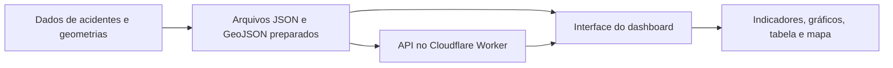

# Painel de Acidentes em Rodovias Federais

O Painel de Acidentes em Rodovias Federais é um dashboard interativo para explorar registros de acidentes nas rodovias federais brasileiras entre 2017 e 2024.

**[Acessar o dashboard](https://dashboard-acidentes-prf.guisoaresg7.workers.dev/)**

## Visão geral

O painel reúne indicadores e gráficos para observar a frequência e a gravidade dos acidentes. Os dados podem ser analisados por ano e por estado (UF), usando os filtros no próprio dashboard.

Entre as informações apresentadas estão:

- totais de acidentes, mortes e feridos;
- evolução anual de acidentes e mortes;
- taxa de severidade;
- distribuição de acidentes por horário;
- principais causas registradas;
- comparação e ranking entre estados;
- tabela detalhada dos registros disponíveis no recorte selecionado.

Os filtros de ano e estado atualizam os indicadores, gráficos, tabela e dados de ocorrências do mapa. A seleção de uma rodovia federal (BR) é específica do mapa: ela destaca a rodovia escolhida e exibe as ocorrências associadas, sem alterar os demais indicadores do painel.

## Mapa interativo

O mapa é desenhado com geometrias vetoriais próprias do Brasil, dos estados e das rodovias federais. Assim, os limites e os traçados não dependem de um mapa-base externo.

É possível selecionar uma BR pelo menu ou clicando diretamente em seu traçado. Quando uma rodovia é selecionada, ela ganha destaque e as demais ficam apagadas para facilitar a leitura. Os controles de zoom permitem aproximar e afastar a visualização.

O controle **Acidentes** oferece três modos:

- **Pontos:** mostra ocorrências individualmente no mapa;
- **Calor:** representa a concentração espacial dos acidentes;
- **Ocultar:** esconde as ocorrências e mantém a visualização geográfica e rodoviária.

O recorte do mapa acompanha os filtros de ano e estado. Para manter a navegação responsiva, a visualização pode exibir uma amostra limitada de ocorrências; o painel informa o total correspondente ao recorte quando uma BR é selecionada.

## Como o dashboard funciona

Os dados de acidentes e as geometrias geográficas são preparados antes de serem publicados. Essa etapa transforma as fontes em arquivos JSON e GeoJSON menores e organizados por finalidade, como resumos, mapas, tabelas, limites estaduais e trechos rodoviários.

No site, a interface carrega os arquivos estáticos e solicita à API os dados correspondentes aos filtros selecionados. A API valida o ano e a UF, localiza o arquivo preparado para aquela combinação e devolve a resposta em JSON. Os resumos são mantidos em cache durante a execução do Worker para evitar leituras repetidas.

Esse fluxo permite que o site apresente as informações sem processar o CSV bruto a cada acesso:



## Dados em JSON

Os arquivos JSON são respostas já organizadas para o dashboard. Em vez de enviar a base completa para o navegador, o site solicita somente o conjunto de dados necessário para a visualização e os filtros atuais.

- **Resumo:** agrega indicadores e séries para o painel, incluindo combinações de ano e UF.
- **Mapas:** contém ocorrências geolocalizadas para o mapa geral e para recortes filtrados.
- **Tabelas:** contém linhas detalhadas de acidentes para preencher a tabela de registros.
- **Geometrias:** arquivos GeoJSON descrevem limites do Brasil e estados, além dos trechos de rodovias.
- **Acidentes por BR:** arquivos separados permitem consultar e desenhar ocorrências associadas a cada rodovia.

Os arquivos disponibilizados em `public/data/` são recursos públicos, usados pelo site para montar as visualizações. Eles não devem conter informações privadas.

## API do dashboard

As rotas `/api/*` fornecem os dados consumidos pela interface. As rotas de resumo aceitam os parâmetros opcionais `ano` e `uf`.

| Rota | Dados fornecidos |
|---|---|
| `/api/stats_gerais` | Totais de acidentes, mortes e feridos |
| `/api/acidentes_por_ano` | Série anual de acidentes |
| `/api/mortos_por_ano` | Série anual de mortes |
| `/api/taxa_severidade` | Indicadores de severidade |
| `/api/heatmap_horarios` | Distribuição por horário |
| `/api/ranking_estados` | Ranking das UFs |
| `/api/causas` | Principais causas registradas |
| `/api/estados` | Totais por UF |
| `/api/mapa` | Ocorrências para o mapa |
| `/api/tabela_detalhada` | Linhas para a tabela detalhada |
| `POST /api/analista/consulta` | Consultas determinísticas para o analista de dados; não chama um modelo de IA |

O endpoint de consulta recebe um objeto JSON com uma operação e seus parâmetros. Operações disponíveis:

- `consultar_resumo`: `ano`, `uf` e `metrica` opcionais; métricas aceitas: `acidentes`, `mortes` e `feridos`.
- `comparar_estados`: `ufs` (2 a 10 siglas), `metrica` e `ano` opcionais.
- `listar_causas`: `ano`, `uf` e `limite` opcionais; o limite máximo é 10.
- `consultar_serie`: `metrica` (`acidentes` ou `mortes`), `uf`, `ano_inicio` e `ano_fim` opcionais.

Exemplo de comparação:

```json
{
  "operacao": "comparar_estados",
  "ano": 2023,
  "ufs": ["GO", "SP"],
  "metrica": "mortes"
}
```

O endpoint valida a consulta e retorna os valores estruturados com filtros e fonte. Ele não interpreta linguagem natural; séries anuais de feridos ainda não estão nos dados preparados.

O período coberto é de 2017 a 2024. Uma UF deve ser informada pela sigla oficial, como `SP` ou `BA`.

## Fontes dos dados

- **Acidentes:** dataset [Acidentes em Rodovias Federais](https://www.kaggle.com/datasets/guilherme2008/acidentes-em-rodovias-federais), baseado em registros da PRF.
- **Rodovias:** [DNIT/Infra S.A. — Rodovias Federais, SNV 202501A](https://geo.infrasa.gov.br/server/rest/services/Hosted/Rodovias_Federais/FeatureServer/0).
- **Limites do Brasil e das UFs:** [IBGE — API de Malhas Geográficas](https://servicodados.ibge.gov.br/api/docs/malhas?versao=3).

## Tecnologias

O projeto usa Python, Flask e Cloudflare Workers na API; Workers Static Assets para servir a interface e os dados preparados; e JavaScript, Chart.js e Leaflet para os gráficos e as interações do navegador.

## Processo de desenvolvimento e uso de IA

O desenvolvimento combinou decisões e iterações do autor com o uso do **ChatGPT (modelo GPT-6, acessado pelo Codex)** como ferramenta de apoio. A IA auxiliou na implementação de funcionalidades, investigação de problemas, ajustes de responsividade e documentação.

O autor conduziu a evolução do produto: definiu os objetivos e prioridades, avaliou as sugestões, escolheu os comportamentos do mapa e dos filtros, e refinou a experiência a partir dos resultados observados. Esse processo demonstra aplicação prática de análise de requisitos, integração de dados, desenvolvimento web e avaliação iterativa de soluções com IA.

## Código-fonte

O código do projeto está disponível no [GitHub](https://github.com/guig7/Dashboard_acidentes).

## Licença

Este projeto está sob a licença MIT. Consulte o arquivo [License](License).

