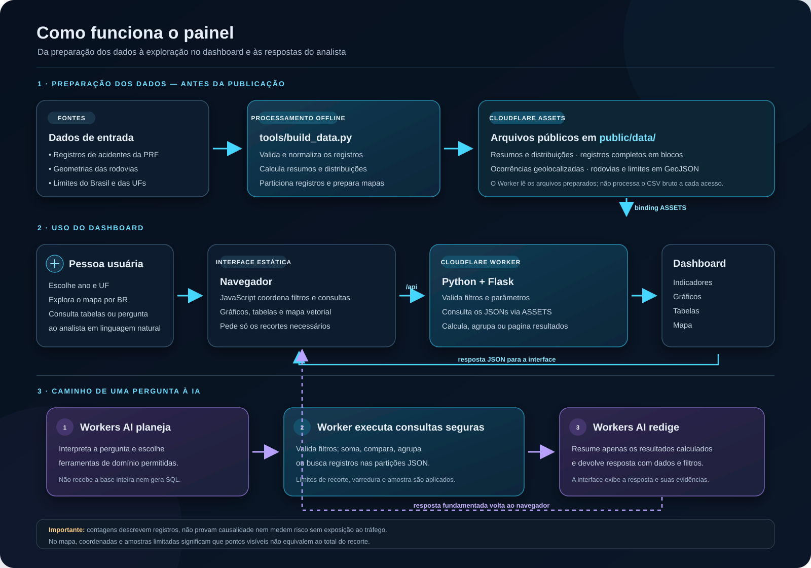

# Painel de Acidentes em Rodovias Federais

Dashboard interativo para explorar registros de acidentes em rodovias federais brasileiras entre 2017 e 2024. O painel combina indicadores, gráficos, distribuições, registros detalhados, mapa vetorial e um analista que responde perguntas sobre os dados por meio de consultas controladas.

**[Acessar o dashboard](https://dashboard-acidentes-prf.guisoaresg7.workers.dev/)**

## Objetivo e limites de interpretação

O painel facilita a exploração descritiva dos registros da Polícia Rodoviária Federal (PRF). Ele permite observar como os registros se distribuem por ano, UF, rodovia, horário, condição meteorológica, causa informada e outros campos.

Os resultados representam o que foi registrado na base. Por si só, não demonstram que uma condição causou um acidente, não medem o risco de uma rodovia ou grupo de usuários e não justificam alertas operacionais. Para comparar risco seriam necessários denominadores de exposição ao tráfego, como volume de veículos e distância percorrida, que não fazem parte deste conjunto de dados. O painel também não prevê acidentes futuros.

## O que o site oferece

- **Filtros globais de ano e UF:** atualizam indicadores, gráficos, distribuições, registros e ocorrências do mapa.
- **Indicadores e gráficos:** totais de acidentes, mortes e feridos; séries anuais; distribuição por horário; causas registradas; e ranking estadual por taxa de severidade.
- **Exploração de dimensões:** tabela paginada que agrupa a base por dimensões categóricas e ordena por acidentes, mortes, feridos, pessoas, veículos e outras métricas.
- **Registros completos:** tabela paginada dos registros, com os 30 campos da base disponíveis em cada linha.
- **Mapa:** limites do Brasil e das UFs, traçados de rodovias, ocorrências geolocalizadas e modos de exibição por pontos, calor ou ocultação.
- **Analista de dados:** perguntas em português sobre os dados, incluindo comparações, séries, distribuições e consultas detalhadas com filtros combinados.

O seletor de BR é independente dos demais componentes: ele destaca o traçado e filtra as ocorrências **do mapa**, mas não altera indicadores, gráficos nem tabelas.

## Arquitetura

O CSV bruto é processado antes da publicação. O Worker não baixa nem percorre o CSV a cada acesso; ele consulta os arquivos preparados publicados como Static Assets. A interface obtém dados da API ou carrega diretamente os recursos públicos necessários ao mapa.

### Componentes

- **Pré-processamento:** `tools/build_data.py` lê o CSV, normaliza valores e gera resumos, distribuições, páginas iniciais, partições de registros e recursos geográficos. Essa etapa usa pandas e acontece fora das requisições do site.
- **Arquivos publicados:** `public/` é o diretório de Static Assets configurado no Wrangler. Os recursos em `public/data/` são públicos; não devem conter segredos nem dados privados.
- **Worker e API:** `src/worker.py` expõe as rotas Flask `/api/*`. O binding `ASSETS` lê os JSONs e GeoJSONs publicados. Resumos e o manifesto de registros são mantidos em cache durante a vida de uma instância do Worker.
- **Interface:** `templates/index.html`, `static/script.js` e `static/style.css` são as cópias de desenvolvimento. O Wrangler publica a interface e os arquivos estáticos correspondentes em `public/`. Ao alterar a interface, as cópias `templates/index.html` / `public/index.html`, `static/script.js` / `public/static/script.js` e `static/style.css` / `public/static/style.css` devem permanecer sincronizadas; no HTML, os caminhos de assets podem diferir entre o template Flask e a versão estática.
- **Mapa:** Leaflet desenha as geometrias vetoriais próprias do projeto. Chart.js cria os gráficos; bibliotecas e fontes da interface são carregadas por CDNs. O mapa não depende de tiles de mapa-base externos.

## Preparação e organização dos dados

As fontes do projeto são:

- **Acidentes:** dataset [Acidentes em Rodovias Federais](https://www.kaggle.com/datasets/guilherme2008/acidentes-em-rodovias-federais), baseado em registros da PRF.
- **Rodovias federais:** geometrias do [DNIT / Infra S.A.](https://geo.infrasa.gov.br/server/rest/services/Hosted/Rodovias_Federais/FeatureServer/0).
- **Brasil e UFs:** malhas geográficas da [API de Malhas do IBGE](https://servicodados.ibge.gov.br/api/docs/malhas?versao=3).

Na preparação, o CSV é lido como arquivo separado por ponto e vírgula e codificado em Latin-1. O processo valida as colunas esperadas, converte campos numéricos, normaliza BR e UF, interpreta datas nos formatos encontrados na fonte e deriva ano, mês e hora para as análises. Registros sem coordenadas válidas continuam nos resumos, distribuições e consultas tabulares; apenas registros com coordenadas válidas e plausíveis podem ser desenhados no mapa.

Na versão dos dados atualmente preparada, o manifesto contabiliza 547.347 registros e 30 campos por registro. Essa contagem pode mudar quando a fonte for atualizada.

Os principais recursos gerados em `public/data/` são:

| Arquivo ou diretório | Conteúdo e uso |
|---|---|
| `summary.json` | Indicadores, séries, causas, estados, severidade e horário, preparados para cada combinação de filtros globais. |
| `analytics/` | Distribuições completas por dimensão e métrica, também preparadas para os recortes de ano e UF. |
| `records/manifest.json` | Esquema, quantidade de registros, tamanho dos blocos e partições de ano e UF. |
| `records/` | Registros completos em blocos JSON; cada linha preserva os 30 campos da base. |
| `maps/` | Ocorrências geolocalizadas preparadas para os filtros de ano e UF. |
| `tables/` | Recortes tabulares compactos mantidos para a rota de tabela detalhada compatível. |
| `roads/` | Geometrias das rodovias e limites do Brasil e dos estados em GeoJSON. |
| `roads/accidents/` | Ocorrências geolocalizadas organizadas por BR para a seleção de rodovia no mapa. |

O pré-processamento gera os recortes necessários para “todos”, cada ano, cada UF e cada combinação de ano e UF. Os arquivos completos de registros são divididos em blocos, em vez de um único JSON grande. Isso permite que a API localize a partição relevante sem entregar a base inteira ao navegador.

**Totais e amostras são coisas diferentes.** Resumos e distribuições contam os registros do recorte, inclusive os que não têm coordenadas. O mapa apresenta somente ocorrências geolocalizadas e pode limitar os pontos desenhados para manter a navegação responsiva: até 2.000 no mapa geral, até 500 nos mapas com filtros de ano/UF e até 2.500 pontos exibidos quando uma BR está selecionada. Quando houver limite, pontos visíveis não devem ser interpretados como todos os acidentes do recorte; o status do mapa informa o total correspondente.

## Como o dashboard carrega os dados

1. A interface inicia as consultas de indicadores, gráficos, distribuições, registros e mapa.
2. Os filtros globais são enviados como `ano` e `uf` às rotas correspondentes. A API valida esses parâmetros e seleciona os JSONs já preparados para o recorte.
3. A tabela de distribuições busca uma dimensão e uma métrica por página; a tabela de registros solicita uma página do manifesto e dos blocos necessários.
4. O mapa obtém a amostra geolocalizada adequada ao filtro. Ao selecionar uma BR, carrega as ocorrências e o traçado da rodovia e aplica ano/UF no mapa.
5. Os recursos geográficos usam cache de promessas em andamento para evitar downloads duplicados. As requisições têm timeout e uma sequência de atualização impede que uma resposta antiga substitua os dados de filtros mais recentes. Em mudanças rápidas nos filtros globais, a atualização é agrupada por um debounce curto.

Erros de API ou de carregamento do mapa são sinalizados na interface; os dados anteriores não devem ser apresentados como se correspondessem a um novo recorte.

## API

As rotas retornam JSON. Rotas que recebem filtros de ano/UF aceitam os anos de 2017 a 2024 e siglas válidas de UFs. Erros de validação e indisponibilidade de dados são devolvidos com uma mensagem no campo `erro`.

| Rota | Função |
|---|---|
| `GET /api/stats_gerais` | Totais de acidentes, mortes e feridos e outras métricas gerais. |
| `GET /api/acidentes_por_ano` | Série de acidentes por ano. |
| `GET /api/mortos_por_ano` | Série de mortes por ano. |
| `GET /api/taxa_severidade` | Mortes por acidente e comparação com o período anterior disponível. É uma métrica descritiva da base, não uma medida de risco. |
| `GET /api/heatmap_horarios` | Registros por faixa horária e severidade descritiva. |
| `GET /api/ranking_estados` | Ranking preparado de UFs por taxa de severidade. |
| `GET /api/causas` | Causas registradas mais frequentes. |
| `GET /api/estados` | Totais por UF. |
| `GET /api/mapa` | Ocorrências geolocalizadas para os filtros `ano` e `uf`. |
| `GET /api/tabela_detalhada` | Recorte compacto de tabela mantido para compatibilidade. |
| `GET /api/distribuicao` | Distribuição paginada por dimensão e métrica; aceita `ano`, `uf`, `dimensao`, `metrica`, `pagina` e `por_pagina`. |
| `GET /api/registros` | Registros completos paginados; aceita `ano`, `uf`, `pagina` e `por_pagina`. |
| `POST /api/analista/consulta` | Executa uma consulta determinística permitida, sem chamar um modelo de IA. |
| `GET /api/analista/status` | Informa se o analista com IA está habilitado e com os bindings necessários. |
| `POST /api/analista/perguntar` | Interpreta uma pergunta com Workers AI e executa consultas determinísticas permitidas. |

### Distribuições e registros

`GET /api/distribuicao` agrupa por dimensões como ano, mês, dia da semana, fase do dia, condição meteorológica, tipo e classificação de acidente, UF, BR, município, causa, regional, delegacia e unidade operacional. As métricas incluem acidentes, mortes, tipos de feridos, pessoas, ilesos, ignorados e veículos. O endpoint aceita até 100 categorias por página; a interface apresenta 25 por página.

`GET /api/registros` retorna o total do recorte e os registros de uma página. A página padrão tem 50 linhas, com máximo de 100. Sem filtros, a rota pode paginar o conjunto completo; aplicar ano ou UF restringe a consulta às partições correspondentes. Cada linha contém os 30 campos da fonte, incluindo data, horário, UF, BR, km, município, condições, classificação, pessoas, vítimas, veículos, coordenadas e unidades da PRF.

## Analista de dados com Workers AI

O analista combina linguagem natural com consultas determinísticas ao conteúdo estruturado em `public/data/`. O modelo **não recebe o DataFrame nem a base inteira** e não executa código Python ou SQL arbitrário.

O fluxo de uma pergunta é:

1. O navegador verifica `GET /api/analista/status` e só habilita o formulário quando o recurso está disponível.
2. A pergunta é enviada a `POST /api/analista/perguntar`. O Worker valida que há um texto e limita a pergunta a 500 caracteres.
3. Workers AI seleciona uma ou mais ferramentas de domínio — resumo, comparação de UFs, causas, série, distribuição, análise de registros ou recusa.
4. O Worker valida os argumentos e calcula ou carrega os resultados dos JSONs preparados. O plano pode conter até cinco consultas, no máximo duas delas detalhadas.
5. Para registros, `analisar_registros` combina filtros exatos em até dez campos, intervalos inclusivos de data ou km, agrupamento por campo ou amostra de linhas. É necessário informar ano ou UF; cada busca pode examinar no máximo 40.000 registros e devolver até dez grupos ou exemplos. A API valida os campos, tipos e limites antes de ler os blocos.
6. Um segundo passo de Workers AI redige uma explicação em português a partir somente dos resultados. A resposta não deve inventar números nem transformar associação em causalidade.
7. A API devolve a resposta, as consultas, os filtros, os resultados e a fonte em campos separados. A interface mostra o texto e permite abrir os detalhes da consulta e da fonte.

Os filtros globais do dashboard não são aplicados automaticamente à pergunta: o usuário deve incluir na pergunta o ano, a UF ou outro recorte desejado. Buscas detalhadas muito amplas são recusadas e solicitam um recorte menor. Perguntas fora do escopo, previsões futuras e cálculos de risco sem dados de exposição também devem ser recusados.

O modelo configurado é `@cf/zai-org/glm-4.7-flash`, vinculado pelo binding `AI`. O planejamento tem limite de 512 tokens de conclusão e a síntese, de 700; a resposta textual é limitada a 2.000 caracteres. O binding e a variável `ANALYST_AI_ENABLED` são declarados em `wrangler.jsonc`.

O endpoint de perguntas usa o Rate Limiting API do Workers, configurado para cinco chamadas por minuto por chave de IP. É um controle operacional aproximado, não um teto global ou diário de consumo: a aplicação não implementa um orçamento rígido de gastos. O uso de Workers AI deve ser acompanhado no painel da Cloudflare; a aplicação não mantém um registro próprio de consumo nem usa AI Gateway ou armazenamento próprio de conversas. Workers Observability está habilitado para observabilidade de invocações e exceções. Limites, retenção e cobrança dependem da configuração e do plano da Cloudflare.

## Fontes, testes e estrutura do repositório

Os testes cobrem o pré-processamento, a validação e execução de consultas, a paginação de registros, os limites da análise detalhada, o contrato do Worker e perguntas de referência com resultados esperados. As perguntas de referência incluem exemplos que devem ser recusados, como previsão futura ou risco sem denominador de exposição.

Principais diretórios e arquivos:

| Caminho | Responsabilidade |
|---|---|
| `src/worker.py` | Rotas Flask, acesso a Static Assets, cache do manifesto e ligação com Workers AI. |
| `src/analyst_ai.py` | Ferramentas do modelo, limites, validação do plano e síntese das respostas. |
| `src/analyst_queries.py` | Operações determinísticas sobre resumos e distribuições. |
| `src/record_queries.py` | Paginação, filtros, agrupamentos e amostras dos registros completos. |
| `src/data_schema.py` | Esquema comum de campos, dimensões e métricas. |
| `tools/build_data.py` | Pré-processamento e geração de JSON/GeoJSON. |
| `templates/`, `static/` | Interface de origem. |
| `public/` | Interface publicada e dados públicos preparados. |
| `tests/` | Testes unitários e casos de referência do analista. |
| `wrangler.jsonc` | Configuração do Worker, Static Assets, Workers AI, rate limit e observabilidade. |

O desenvolvimento combinou decisões e iterações do autor com o uso do **ChatGPT (modelo GPT-6, acessado pelo Codex)** como ferramenta de apoio. A IA auxiliou na implementação de funcionalidades, investigação de problemas, ajustes de responsividade e documentação. O autor definiu objetivos e prioridades, avaliou sugestões e conduziu a evolução do produto.

## Código-fonte e licença

O código está disponível no [GitHub](https://github.com/guig7/Dashboard_acidentes). Este projeto está sob a licença MIT; consulte o arquivo [License](License).
